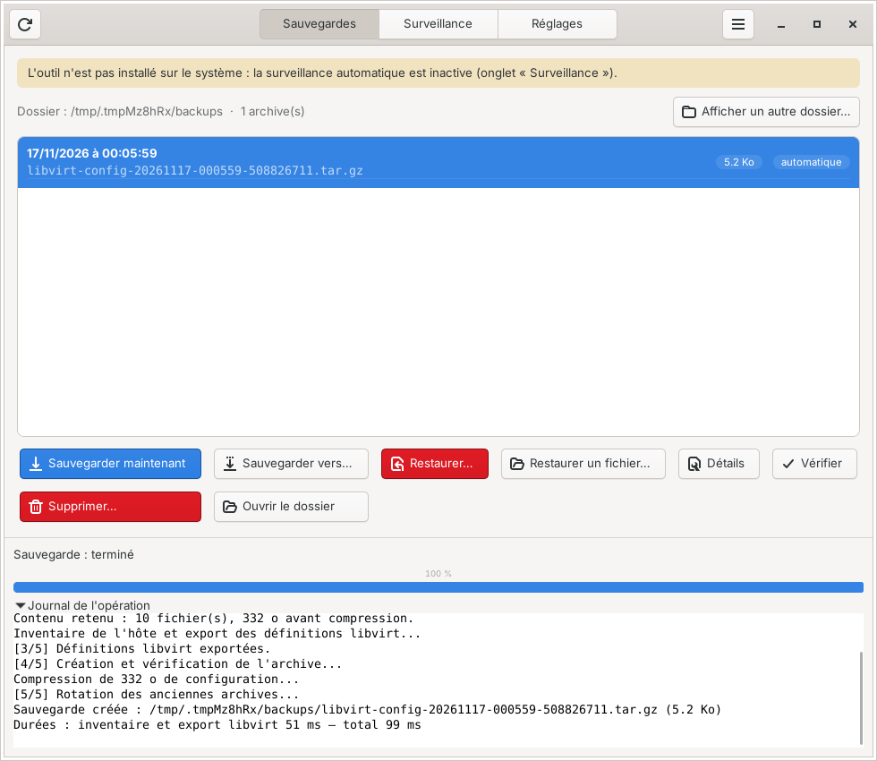
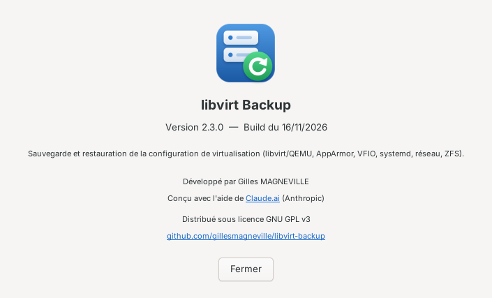

<p align="center">
  
</p>

<h1 align="center">libvirt Backup</h1>

<p align="center">
  🇬🇧 <a href="README.md">Read in English</a><br>
  <em>Sauvegarde et restauration de la configuration d'un hôte libvirt/QEMU — interface GTK4 et ligne de commande.</em>
</p>

<p align="center">
  <a href="https://github.com/gillesmagneville/libvirt-backup/releases/latest"></a>
  <a href="LICENSE"></a>
  
  
  
  
</p>

<p align="center">
  
</p>

## Téléchargement

La dernière version stable est sur la [page des versions](https://github.com/gillesmagneville/libvirt-backup/releases/latest). Il n'y a rien à compiler pour utiliser le logiciel.

| Fichier | Contenu |
|---|---|
| `libvirt-backup_2.3.0-1_amd64.deb` | la ligne de commande, ses pages de manuel (anglais et français) et la surveillance — sans GTK, adapté aux hôtes sans écran |
| `libvirt-backup-gui_2.3.0-1_amd64.deb` | l'interface GTK4, son entrée de menu, ses icônes et l'action polkit (nécessite le premier paquet) |

Les deux paquets sont en `amd64`, construits sur Ubuntu 24.04 LTS : ils demandent glibc 2.39 et GTK 4.10 ou plus récents (Ubuntu 24.04 et suivantes, Debian 13 et suivantes). Chaque fichier est accompagné d'un fichier `.sha256`. Vérifie, puis installe :

```bash
cd ~/Téléchargements
sha256sum -c libvirt-backup_2.3.0-1_amd64.deb.sha256 libvirt-backup-gui_2.3.0-1_amd64.deb.sha256
sudo apt install ./libvirt-backup_2.3.0-1_amd64.deb ./libvirt-backup-gui_2.3.0-1_amd64.deb
sudo libvirt-backup install     # demande où ranger les archives, crée les réglages et le service de surveillance
```

Sauvegarde et restauration de la configuration d'un hôte de virtualisation libvirt/QEMU — définitions des VM, réseaux, pools, NVRAM/TPM, profils AppArmor, unités systemd, réglages VFIO/GRUB/initramfs, scripts locaux… — depuis une **interface GTK4** ou en **ligne de commande**. Il remplace les deux scripts shell d'origine (`install-libvirt-autobackup.sh`, `restore-libvirt-backup.sh`) et est **inclus dans chaque sauvegarde** : une machine vierge peut tout restaurer à partir d'une seule archive.

Écrit en Rust : la ligne de commande est **un seul exécutable autonome** (ni Python, ni GTK, aucun environnement à installer) ; seule l'interface graphique, facultative, demande GTK 4.

## Fonctionnalités

- Sauvegarde automatique à chaque modification sous `/etc/libvirt`, `/etc/apparmor.d`, … (surveillance inotify, service systemd `Type=notify`, regroupement des rafales).
- **Tu choisis où vont les archives** (disque interne, clé USB, partage réseau…) — voir ci-dessous.
- Archives `libvirt-config-AAAAMMJJ-HHMMSS-NNNNNNNNN.tar.gz` avec rotation (30 conservées) et un lien `libvirt-config-latest.tar.gz`. Même format que les anciens scripts : **les archives existantes restent restaurables**.
- **Sauvegardes rapides et allégées** : seul l'état persistant de libvirt et sa configuration sont archivés — pas les programmes compilés rangés dans `/usr/local/bin` (voir *Sauvegardes allégées* ci-dessous). Chaque exécution affiche la durée de chaque phase.
- Restauration par **groupe** (voir plus bas), en *fusion* (rien n'est supprimé), après une archive de sécurité automatique `pre-restore-safety-*.tar.gz`.
- **Suppression d'une archive** devenue inutile (CLI `delete`, interface *Supprimer…*), après un avertissement et une confirmation explicite.
- Contrôles avant toute modification : CRC gzip complet, refus des chemins absolus, de `..`, des périphériques, des liens physiques dangereux et des chemins hors liste blanche.
- VM : NVRAM/TPM restaurés seulement si toutes les VM sont `shut off` ; réseaux, pools et domaines redéfinis avec `virsh` depuis les XML exportés.
- **Une vraie jauge de progression** pendant une sauvegarde : une barre avec un pourcentage dans le terminal, une barre de progression dans la fenêtre, des événements `progress` avec `--json`.
- **Multilingue** : anglais, français, allemand et espagnol, dans la ligne de commande, la fenêtre, les pages de manuel (anglais et français) et l'entrée de menu.
- Flux d'événements `--json` pour l'automatisation (l'interface graphique l'utilise).

## Langues

La ligne de commande et la fenêtre parlent **anglais, français, allemand et espagnol**. La langue est choisie dans cet ordre, la première qui est définie l'emporte :

| Ordre | Source |
|---|---|
| 1 | `--language en\|fr\|de\|es` sur la ligne de commande |
| 2 | la variable d'environnement `LIBVIRT_BACKUP_LANG` |
| 3 | le réglage `language` : `config set language=fr` (`system`, `en`, `fr`, `de`, `es`) ; dans la fenêtre, *Menu* → *Préférences* (enregistré pour chaque utilisateur dans `~/.config/libvirt-backup/gui.json`) |
| 4 | la langue du système (`LC_ALL`, `LC_MESSAGES`, `LANG`) |
| 5 | l'anglais |

- Une langue du système non prise en charge (l'italien, par exemple) se replie sur l'anglais ; la fenêtre te le dit une fois, au démarrage, et les *Préférences* permettent d'en choisir une autre. Un changement de langue dans la fenêtre s'applique au prochain démarrage.
- La fenêtre transmet sa langue à la ligne de commande qu'elle lance via `pkexec` : les messages d'une opération sont dans la langue de la fenêtre.
- Les mots de confirmation suivent la langue (`RESTAURER` / `RESTORE` / `WIEDERHERSTELLEN` / `RESTAURAR`, `SUPPRIMER` / `DELETE` / `LÖSCHEN` / `ELIMINAR`) ; **les mots français sont toujours acceptés**, les exemples des anciens scripts continuent donc de fonctionner.
- Le nom du produit, *libvirt Backup*, n'est pas traduit. Les messages que `clap` écrit lui-même pour une ligne de commande erronée (et les listes `[possible values]`) restent en anglais. Les journaux du système suivent la langue du processus qui les écrit.
- Les textes allemands et espagnols ont été écrits avec l'aide de Claude et n'ont pas été relus par des locuteurs natifs : les corrections sont bienvenues (voir [CONTRIBUTING.fr.md](CONTRIBUTING.fr.md)).

## Jauge de progression

Une sauvegarde indique sa progression réelle, de la première requête au contrôle final :

- Dans un terminal, la ligne sous l'étape en cours affiche une barre, le pourcentage et le temps écoulé, par exemple `[██████████░░░░░░░░░░░░░░] 42 %   Temps écoulé : 31s`. Sans terminal (fichier journal, surveillance), une ligne est écrite toutes les quelques secondes à la place.
- Dans la fenêtre, une barre de progression montre le pourcentage pendant une sauvegarde. Pour les autres opérations (restauration, suppression…), la barre suit les étapes et ne recule jamais.
- Avec `--json`, des événements `{"event":"progress","fraction":0.4200}` sont émis (environ 200 au plus par sauvegarde, jamais en arrière, `fraction` de 0 à 1). Le premier événement d'une sauvegarde est `progress` 0.0 et le dernier 1.0.
- La jauge est pondérée par ce qui prend du temps : préparation (0–10 %), inventaire libvirt et exports (jusqu'à 45 %), **compression (45–90 %, mesurée sur `tar` lui-même)**, vérification (90–98 %), fin (100 %).

## Choisir l'emplacement des sauvegardes

| Où | Comment |
|---|---|
| Réglage enregistré (service de surveillance et toutes les commandes) | `install --backup-dir DOSSIER` · `config set backup_dir=DOSSIER` · interface → *Réglages* → *Parcourir…* · question posée par `install` dans un terminal |
| Pour une seule exécution, rien d'enregistré | `--backup-dir DOSSIER` sur `backup`, `list`, `info`, `verify`, `restore`, `status` · interface → *Sauvegarder vers…* / *Afficher un autre dossier…* |
| Restaurer depuis n'importe où | `restore /media/moi/CLE/une-archive.tar.gz` · interface → *Restaurer un fichier…* |
| Par défaut | `~/virtualisation` de l'utilisateur propriétaire (comme les anciens scripts) |

Règles, appliquées partout :

- Le chemin doit être absolu (`~/x` et les chemins relatifs sont résolus pour toi) ; `..` est refusé.
- Sur le vrai système, un dossier **situé dans un chemin sauvegardé ou surveillé** (`/etc/libvirt`, `/usr/local/bin`…), un dossier qui **en contient un** (`/`, `/etc`, `/usr`, `/var`) et les emplacements volatils (`/run`, `/proc`, `/sys`, `/dev`) sont refusés : chaque archive déclencherait la suivante.
- `install` avertit si le dossier est sur le même disque que le système (une panne du disque emporterait aussi les sauvegardes).
- Au moment de sauvegarder, le **dossier parent doit exister** : une clé USB ou un partage réseau non monté ne fait jamais atterrir silencieusement les archives sur le disque système. Le dossier lui-même est créé en `0700`, propriété de l'utilisateur choisi.
- Propriétaire, mode `0600` et lien `latest` sont appliqués au mieux sur les systèmes de fichiers qui ne les gèrent pas (FAT/exFAT/NTFS) : un avertissement, pas un échec.
- Le service relit les réglages avant chaque sauvegarde : `config set backup_dir=…` s'applique immédiatement, sans redémarrer le service.

## Sauvegardes allégées

Sur un hôte de virtualisation, ce qui compte est l'**état persistant des VM** : les définitions que libvirt conserve (`/etc/libvirt`, secrets), les fichiers NVRAM/TPM, les profils AppArmor, les unités systemd, les réglages VFIO/GRUB et tes scripts. L'ancien script confiait des dossiers entiers à `tar` : quelques programmes compilés dans `/usr/local/bin` (ou n'importe quel gros fichier) étaient lus, comprimés, puis relus pour le contrôle — des minutes au lieu de quelques secondes.

Le contenu d'une archive est maintenant **établi d'abord** (un parcours des métadonnées, aucun fichier n'est lu), puis remis à `tar` sous forme de liste explicite :

- **Ignorés par défaut** (`lean_backup` = true) : dans `/usr/local/sbin` et `/usr/local/bin`, les exécutables compilés (ELF) et tout fichier de plus de 1 Mio ; partout ailleurs, tout fichier de plus de 16 Mio. L'outil lui-même (groupe `tool`) n'est jamais filtré.
- **Toujours archivés** : configuration, scripts, unités, profils, NVRAM/TPM et les exports `virsh` (XML persistant *et* courant de chaque domaine, réseaux, pools) rangés dans `virsh-exports/`.
- Non sauvegardées : les métadonnées de snapshots et de checkpoints, qui ne sont pas de la configuration.
- `libvirt-backup backup --dry-run` montre ce qui serait archivé (nombre par groupe, taille, plus gros fichiers, fichiers ignorés et pourquoi) sans rien écrire.
- `libvirt-backup backup --full` — ou `config set lean_backup=false`, ou la case à cocher des *Réglages* de l'interface — archive tout, exactement comme le script d'origine.
- Les requêtes `virsh` (états des VM, exports XML, rapport de l'hôte) s'exécutent en parallèle ; le manifeste est le premier élément de l'archive, donc `info` et `list` le lisent sans tout décompresser.
- Chaque exécution se termine par `Durées : …` (états des VM, sélection du contenu, empreinte, inventaire et export libvirt, compression, vérification), également fournies sous `durations` en mode `--json`.

Le format des archives ne change pas : celles faites avant cette option se restaurent comme avant. Avec `--if-changed`, la modification d'un fichier qui n'est *pas* archivé (un binaire recompilé) ne déclenche pas de nouvelle archive.

## Supprimer une archive

```bash
libvirt-backup list
libvirt-backup delete 3                # demande le mot de confirmation SUPPRIMER
libvirt-backup delete 3 5 --yes        # plusieurs archives, sans question (scripts)
```

- Un avertissement indique ce qui va disparaître et signale quand c'est l'archive la **plus récente**, quand **aucune sauvegarde automatique ne resterait**, ou quand c'est une **archive de sécurité avant restauration**. Seules les archives du dossier des sauvegardes peuvent être supprimées (jamais un chemin quelconque). Le lien `libvirt-config-latest` est déplacé vers la plus récente des archives automatiques restantes (ou supprimé avec la dernière).
- Le mot de confirmation est `SUPPRIMER` (`DELETE`, `LÖSCHEN`, `ELIMINAR` dans les autres langues) ; dans l'interface, le bouton **Supprimer…** ouvre une boîte d'avertissement (bouton *Annuler* par défaut). La suppression est définitive : pas de corbeille.
- Elle prend le même verrou que `backup` et `restore` : jamais de conflit avec la surveillance.

## La fenêtre

<p align="center">
  
  
</p>

- Le **menu principal** (le bouton ☰ de la barre de titre) propose *Préférences* (Ctrl+,), *À propos* et *Quitter* (Ctrl+Q).
- **Quitter** ferme la fenêtre. Si une opération est en cours, la question est posée d'abord (*Annuler* par défaut) : la commande déjà lancée **se termine en arrière-plan** et l'archive reste complète ; seule la fenêtre disparaît.
- **À propos** affiche la version et la date de compilation, l'auteur et les remerciements (ci-dessous), la licence et la page du projet.
- Les **Préférences** choisissent la langue de la fenêtre (voir *Langues*).

## Icônes

`data/app.svg` (vectorielle), `data/app-small.svg` (simplifiée, pour 16–32 px) et `data/app-symbolic.svg` (monochrome, suit les couleurs du thème) sont les sources. `packaging/make-icons.sh` régénère les PNG `data/icons/hicolor/{16…512}x…/apps/` (nécessite `rsvg-convert` ; les PNG sont versionnés, la compilation n'a donc besoin de rien). Une installation compilée dépose les icônes vectorielle et symbolique sous `/usr/local/share/icons` ; le `.deb` de l'interface installe tout sous `/usr/share/icons`. Les boutons utilisent les icônes symboliques standard d'Adwaita, avec un repli en texte seul si le thème n'en a pas (le `.deb` recommande `adwaita-icon-theme` et `librsvg2-common` pour cela).

## Dépendances

| | Compilation | Exécution |
|---|---|---|
| Ligne de commande | Rust ≥ 1.87 (`rustup` ou `sudo apt install cargo`) | `tar` GNU, `inotify-tools` (installé par `install` si absent), `sudo` |
| Interface GTK4 | + `sudo apt install build-essential pkg-config libgtk-4-dev` | `libgtk-4-1`, `pkexec` (polkit) |
| Paquets `.deb` | + `dpkg-deb` (toujours présent sous Debian/Ubuntu) ; `dpkg-dev` facultatif (calcule les dépendances de bibliothèques) | installées automatiquement par `apt` |

## Démarrage rapide

```bash
cd ~/Projects/libvirt-backup
make test                              # 97 tests sur une fausse racine, rien ne touche ton système
make gui                               # compile target/release/libvirt-backup et libvirt-backup-gui
./target/release/libvirt-backup install   # demande où ranger les archives, installe l'outil + le service, 1re sauvegarde
libvirt-backup-gui                     # ou : libvirt-backup gui
```

`make build` compile la ligne de commande seule (aucun GTK nécessaire). `install` copie les programmes dans `/usr/local/lib/libvirt-backup/`, crée les lanceurs `/usr/local/bin/libvirt-backup` et `libvirt-backup-gui`, l'entrée de menu, l'action polkit, et active `libvirt-config-backup-watch.service` (même nom que l'ancien service shell : il est remplacé, jamais dupliqué).

## Paquets Debian / Ubuntu

```bash
make deb      # compile en release, puis construit dist/libvirt-backup_*.deb et dist/libvirt-backup-gui_*.deb
sudo apt install ./dist/libvirt-backup_2.3.0-1_amd64.deb ./dist/libvirt-backup-gui_2.3.0-1_amd64.deb
sudo libvirt-backup install     # demande où ranger les archives, crée les réglages et le service de surveillance
```

| Paquet | Contenu |
|---|---|
| `libvirt-backup` | la ligne de commande, la page de manuel et le service de surveillance — **sans GTK**, adapté aux hôtes sans écran |
| `libvirt-backup-gui` | l'interface GTK4, son entrée de menu, son jeu d'icônes (tailles PNG + vectorielle + symbolique) et l'action polkit (dépend de `libvirt-backup`) |

- **Installer un paquet n'active rien.** L'emplacement des archives est ton choix : le service n'est créé que par `libvirt-backup install`.
- Les programmes sont dans `/usr/bin` et appartiennent à dpkg ; l'outil n'y écrit jamais. `install` crée alors seulement `/etc/libvirt-backup/config.json` et le service (`ExecStart=/usr/bin/libvirt-backup watch`).
- **Mise à jour** : le service en cours est redémarré sur le nouveau programme. **`apt remove`** : le service est arrêté et désactivé. **`apt purge`** : l'unité du service et les réglages sont supprimés. Les archives ne sont jamais touchées.
- **L'outil reste dans chaque archive.** Une copie des programmes est ajoutée sous leurs chemins `/usr/local` : la recette de machine vierge ci-dessous fonctionne de la même façon, que l'archive vienne des paquets ou d'un `install` compilé. Restaurer sur une machine installée par les paquets ignore ces fichiers de programme (dpkg en est propriétaire), restaure les réglages et réaligne l'unité du service sur les programmes réellement présents.
- **D'une installation compilée vers les paquets** : installe les paquets puis lance **`sudo /usr/bin/libvirt-backup install`** (chemin complet : une ancienne installation de `/usr/local/bin` passe avant dans le `PATH` et répondrait au nom seul). Il retire les anciennes copies de `/usr/local` et réécrit l'unité ; ouvre ensuite un nouveau terminal (ou `hash -r`). `libvirt-backup status` et le message d'installation du paquet avertissent tant qu'une ancienne installation locale masque le paquet. L'inverse est refusé : un `install` compilé s'arrête avec un message tant que le paquet est installé.
- Les dépendances de bibliothèques sont calculées sur la machine qui construit les paquets (`dpkg-shlibdeps`) : construis-les sur la version d'Ubuntu/Debian visée. `packaging/build-deb.sh` honore `DEB_REVISION=2`, `DEB_MAINTAINER="Nom <mail>"` et `SOURCE_DATE_EPOCH` (construction reproductible).
- Chaque paquet contient la licence (`/usr/share/doc/…/copyright`), la documentation en anglais et en français, et les métadonnées AppStream de l'interface (`io.github.gillesmagneville.LibvirtBackup.metainfo.xml`).

## Ligne de commande

| Commande | Rôle |
|---|---|
| `backup [--if-changed] [--dry-run] [--full]` | créer une archive maintenant, avec une jauge de progression ; `--dry-run` montre le contenu sans rien écrire ; `--full` archive tout (sans filtre allégé) |
| `list` / `info ARCHIVE` | lister les archives / contenu par groupe et README embarqué |
| `verify [ARCHIVE] [--all]` | contrôler l'intégrité et le format |
| `delete ARCHIVE… [--yes]` | supprimer des archives après un avertissement (mot de confirmation : `SUPPRIMER`, ou `DELETE` selon la langue) |
| `restore [ARCHIVE｜--latest] [--only G,…] [--skip G,…] [--dry-run] [--yes]` | restaurer (mot de confirmation interactif : `RESTAURER`, ou `RESTORE` selon la langue) |
| `install [--user U] [--backup-dir D] [--retention N] [--no-first-backup] [--yes]` | installer l'outil + le service |
| `uninstall [--purge]` | retirer le service ; `--purge` retire aussi le programme et les réglages (jamais les archives) |
| `service {status,start,stop,restart,enable,disable}` | piloter la surveillance |
| `status` | installation, service et archives |
| `config {show｜set CLE=VALEUR…} [--restart-service]` | réglages : `backup_user`, `backup_dir`, `retention`, `safety_retention`, `debounce`, `lean_backup`, `language` (`safety_retention` : 0 = tout conserver ; `backup_dir` vide = défaut ; `lean_backup` : true/false ; `language` : system, en, fr, de, es) |
| `groups` | lister les groupes restaurables et leurs chemins |
| `gui` | ouvrir l'interface GTK4 |

Options globales : `--backup-dir DOSSIER`, `--json`, `--language en|fr|de|es`. `ARCHIVE` est un numéro de `list`, un nom de fichier ou un chemin (clé USB, copie…). Les commandes qui exigent root se relancent via `sudo` (jamais en mode `--json` ni sans terminal) ; l'interface graphique utilise `pkexec`. Ctrl+C pendant une sauvegarde ou une restauration s'arrête au prochain point sûr et exécute le nettoyage (verrou, temporaires, redémarrage de la surveillance).

## Groupes restaurables

| Groupe | Contenu |
|---|---|
| `libvirt` | `/etc/libvirt`, `/var/lib/libvirt/secrets` |
| `nvram` | états UEFI/NVRAM et TPM (seulement si toutes les VM sont arrêtées) |
| `apparmor` | `/etc/apparmor.d` |
| `systemd` | unités, tmpfiles, sysctl, limites, règles polkit |
| `scripts` | `/usr/local/sbin`, `/usr/local/bin` |
| `boot` | modprobe/VFIO, udev, GRUB, initramfs, noyau, `numad.conf` |
| `network` | netplan, NetworkManager — *à décocher si l'hôte ou ses cartes réseau ont changé* |
| `storage` | `fstab`, ZFS — *à décocher si les disques ou pools ont changé* |
| `tool` | cet outil lui-même (programmes et réglages) |

## Restaurer sur un système vierge

L'outil est dans chaque archive et c'est un exécutable natif : ni Python, ni GTK, ni chaîne Rust. Sur toute machine de même architecture :

```bash
mkdir -p /tmp/lb
tar -xzf /media/moi/CLE/libvirt-config-latest.tar.gz -C /tmp/lb usr/local/lib/libvirt-backup
sudo /tmp/lb/usr/local/lib/libvirt-backup/libvirt-backup restore /media/moi/CLE/libvirt-config-latest.tar.gz
```

La même recette est écrite dans le README stocké dans chaque archive, et elle vaut aussi pour les archives faites sur une machine installée par les paquets `.deb`.

## Migrer depuis les anciens scripts

Rien à retirer : `install` reprend le service `libvirt-config-backup-watch.service` ; noms d'archives, verrou et étiquettes syslog sont inchangés. Les anciens scripts de `/usr/local/sbin` peuvent être supprimés ensuite (ils font partie du groupe `scripts` d'ici là).

## Fidélité aux scripts d'origine

Mêmes étapes, même ordre, mêmes options : `tar --acls --xattrs --numeric-owner` pour sauvegarder ; `tar --same-owner --same-permissions --acls --xattrs --numeric-owner --delay-directory-restore` pour restaurer (propriétaires, modes, ACL et xattrs d'origine, aux chemins absolus d'origine) ; archive de sécurité avant toute modification ; confirmation `RESTAURER` ; verrou partagé ; VM obligatoirement `shut off` ; rechargement AppArmor, `daemon-reload`, redémarrage de libvirt, `virsh define`, redémarrage de numad ; mêmes réglages d'unité (`Type=notify`, `Restart=always`, `UMask=0077`…) ; mêmes répertoires surveillés (plus les deux de l'outil) et mêmes événements inotify ; rotation de 30 archives ; relance via `sudo` avec le même message (l'interface graphique utilise `pkexec`). Les archives de sécurité ne sont jamais supprimées sauf si tu règles `safety_retention` ; la surveillance sauvegarde après chaque rafale de modifications, même si le contenu est identique.

Différences volontaires :

- **L'extraction utilise `tar --no-recursion`.** Avec GNU tar 1.35, le script de restauration d'origine liste les dossiers *et* leurs fichiers dans `--files-from` ; tar répond alors « Not found in archive » (code 2) et le script s'arrête juste après l'extraction, avant les étapes AppArmor/systemd/libvirt. Corrigé ici.
- L'outil est composé de deux exécutables natifs dans `/usr/local/lib/libvirt-backup/` avec des lanceurs dans `/usr/local/bin/` (au lieu de deux copies `.sh` dans `/usr/local/sbin/`), ou dans `/usr/bin` quand il vient des paquets `.deb`. Il fait partie de chaque archive dans les deux cas (groupes `tool` et `scripts`).
- Le démon notifie systemd lui-même (`NotifyAccess=main` au lieu de `all`).
- Ordre des `virsh define` : réseaux, pools, puis domaines.
- Le propriétaire des archives est par défaut l'utilisateur qui a lancé `sudo`/`pkexec`, et non un nom codé en dur.
- **Sauvegardes allégées** (le seul changement sur *ce qui* est archivé) : les exécutables compilés et les fichiers de plus de 1 Mio de `/usr/local/{sbin,bin}`, ainsi que les fichiers de plus de 16 Mio ailleurs, sont ignorés, car une sauvegarde de cette taille n'est plus une sauvegarde de la configuration. `--full` / `lean_backup=false` rétablit le comportement d'origine.
- Contrôles supplémentaires avant extraction (liens physiques, périphériques) et en plus : choix de l'emplacement, groupes, `--dry-run`, `verify`, `delete`, mode JSON, interface graphique, durées par phase.
- Un `config.json` abîmé n'empêche pas une restauration (valeurs par défaut, avec avertissement) : c'est peut-être justement elle qui le répare.

## Développement

```bash
make test          # 97 tests (intégration et traductions) : fausse racine + faux virsh/systemctl/inotifywait, vrai tar, vrai binaire
make test-gui      # test graphique de bout en bout sous Xvfb (xvfb-run requis) ; captures dans /tmp/gui-shots
make screenshots   # régénère screenshots/en et screenshots/fr (xvfb-run et ImageMagick)
make check         # clippy + rustfmt
make static        # facultatif : ligne de commande statique musl (rustup target add x86_64-unknown-linux-musl)
make deb           # construit dist/*.deb (voir « Paquets Debian / Ubuntu »)
make zip           # construit ../libvirt-backup.zip
```

Les tests ne touchent jamais au vrai système : chaque opération s'exécute sur une fausse racine (`--root`, option cachée) avec de faux `virsh`/`systemctl` en tête du `PATH`. Le vrai systemd, polkit, libvirt et `pkexec` ne sont donc **pas** exercés — essaie d'abord l'installation sur un hôte non critique.

Organisation : `src/` (moteur : `config`, `archive`, `selection`, `backup`, `restore`, `delete`, `service`, `selfinstall`… ; `cli.rs` ; `gui.rs`), `src/bin/` (les deux exécutables), `data/` (entrée de menu, icônes, politique polkit), `src/locales/` (traductions), `packaging/` (constructeur de `.deb`, générateur d'icônes, scripts de maintenance, pages de manuel), `metainfo/` (AppStream), `screenshots/`, `tests/`. Lis [PROJECT_CONTEXT.fr.md](PROJECT_CONTEXT.fr.md) pour l'architecture et les décisions prises.

Les scripts de maintenance des `.deb` et un cycle complet installation → mise à jour → remove → purge ont été exécutés avec dpkg dans un conteneur Ubuntu 24.04 jetable, avec `systemctl` simulé. Comme pour le reste de l'outil, le vrai systemd et `pkexec` ne sont pas exercés par les tests.

## Contribuer, sécurité, journal des modifications

- [CONTRIBUTING.fr.md](CONTRIBUTING.fr.md) — signaler un problème, proposer une modification, ajouter une langue.
- [SECURITY.fr.md](SECURITY.fr.md) — signaler une vulnérabilité (l'outil s'exécute en root).
- [CHANGELOG.fr.md](CHANGELOG.fr.md) — ce qui change dans chaque version.
- [CODE_OF_CONDUCT.fr.md](CODE_OF_CONDUCT.fr.md) — Contributor Covenant 3.0, sous licence CC BY-SA 4.0.

## Licence et remerciements

Développé par **Gilles MAGNEVILLE**, conçu avec l'aide de [Claude.ai](https://claude.ai) (Anthropic).

Distribué sous la licence **GNU General Public License v3.0 uniquement** (GPL-3.0-only) : voir [LICENSE](LICENSE).
