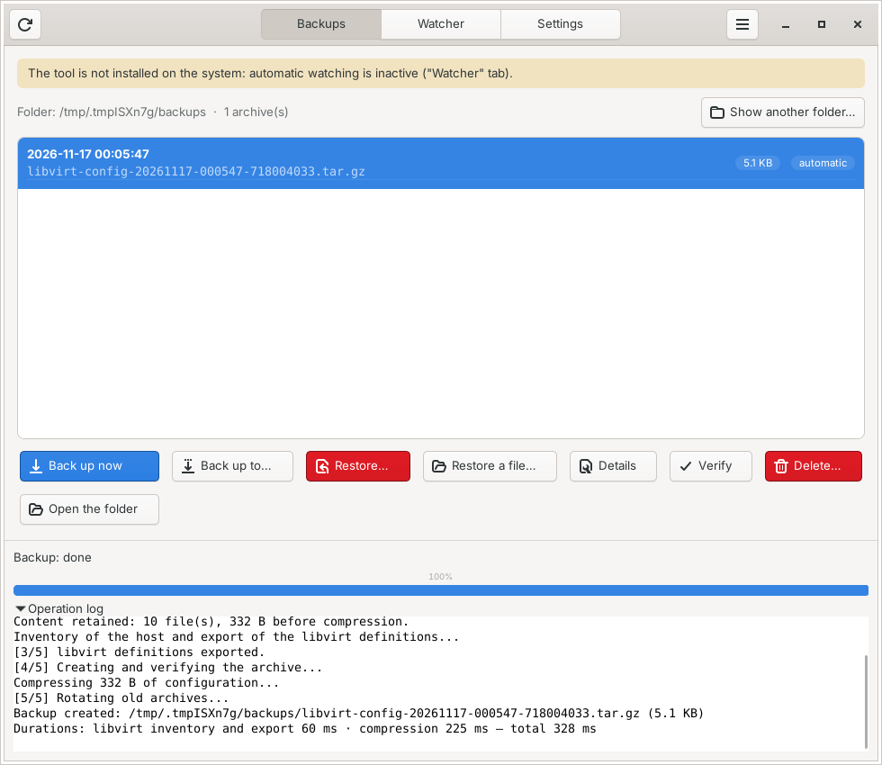
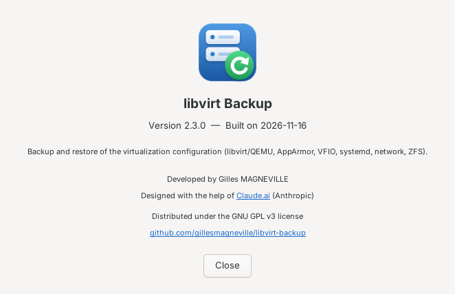
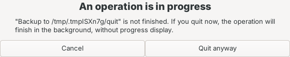

<p align="center">
  
</p>

<h1 align="center">libvirt Backup</h1>

<p align="center">
  🇫🇷 <a href="README.fr.md">Lire en français</a><br>
  <em>Back up and restore the configuration of a libvirt/QEMU host — GTK4 interface and command line.</em>
</p>

<p align="center">
  <a href="https://github.com/gillesmagneville/libvirt-backup/releases/latest"></a>
  <a href="LICENSE"></a>
  
  
  
  
</p>

<p align="center">
  
</p>

## Download

The latest stable release is on the [Releases page](https://github.com/gillesmagneville/libvirt-backup/releases/latest). End users do not need to build anything.

| File | Content |
|---|---|
| `libvirt-backup_2.3.0-1_amd64.deb` | the command line, its man pages (English and French) and the watcher — no GTK, suited to headless hosts |
| `libvirt-backup-gui_2.3.0-1_amd64.deb` | the GTK4 interface, its menu entry, icons and polkit action (needs the first package) |

Both packages are `amd64`, built on Ubuntu 24.04 LTS: they need glibc 2.39 and GTK 4.10 or newer (Ubuntu 24.04 and later, Debian 13 and later). Each file comes with a `.sha256` file. Check, then install:

```bash
cd ~/Downloads
sha256sum -c libvirt-backup_2.3.0-1_amd64.deb.sha256 libvirt-backup-gui_2.3.0-1_amd64.deb.sha256
sudo apt install ./libvirt-backup_2.3.0-1_amd64.deb ./libvirt-backup-gui_2.3.0-1_amd64.deb
sudo libvirt-backup install     # asks where to store the archives, creates the settings and the watcher service
```

Backup and restore the configuration of a libvirt/QEMU virtualization host — VM definitions, networks, pools, NVRAM/TPM, AppArmor profiles, systemd units, VFIO/GRUB/initramfs settings, local scripts… — from a **GTK4 interface** or the **command line**. It replaces the two original shell scripts (`install-libvirt-autobackup.sh`, `restore-libvirt-backup.sh`) and is itself **included in every backup**, so a bare machine can restore everything from a single archive.

Written in Rust: the command line is **one self-contained executable** (no Python, no GTK, no runtime to install); only the optional graphical interface needs GTK 4.

## Features

- Automatic backup on every change under `/etc/libvirt`, `/etc/apparmor.d`, … (inotify watcher, systemd `Type=notify` service, debounce).
- **You choose where the archives go** (internal disk, USB drive, network share…) — see below.
- Archives `libvirt-config-YYYYmmdd-HHMMSS-NNNNNNNNN.tar.gz` with rotation (30 kept) and a `libvirt-config-latest.tar.gz` link. Same format as the old scripts: **existing archives stay restorable**.
- **Fast, lean backups**: only the persistent libvirt state and its configuration is archived — not compiled programs sitting in `/usr/local/bin` (see *Lean backups* below). Every run prints the duration of each phase.
- Restore by **group** (see below), as a *merge* (nothing is deleted), after an automatic safety archive `pre-restore-safety-*.tar.gz`.
- **Delete an archive** you no longer want (CLI `delete`, GUI *Delete…*), after a warning and an explicit confirmation.
- Archive checks before touching anything: full gzip CRC, refusal of absolute paths, `..`, devices, dangerous hard links and paths outside the whitelist.
- VMs: NVRAM/TPM are restored only when every VM is `shut off`; networks, pools and domains are re-defined with `virsh` from the exported XML.
- **A real progress gauge** while a backup runs: a bar with a percentage in the terminal, a progress bar in the window, `progress` events with `--json`.
- **Multilingual**: English, French, German and Spanish, in the command line, the window, the man pages (English and French) and the desktop entry.
- `--json` event stream for scripting (the GUI uses it).

## Languages

The command line and the window speak **English, French, German and Spanish**. The language is chosen in this order, the first one that is set wins:

| Order | Source |
|---|---|
| 1 | `--language en\|fr\|de\|es` on the command line |
| 2 | the `LIBVIRT_BACKUP_LANG` environment variable |
| 3 | the `language` setting: `config set language=fr` (`system`, `en`, `fr`, `de`, `es`); in the window, *Menu* → *Preferences* (stored per user in `~/.config/libvirt-backup/gui.json`) |
| 4 | the language of the system (`LC_ALL`, `LC_MESSAGES`, `LANG`) |
| 5 | English |

- A system language that is not supported (Italian, say) falls back to English; the window tells you once, at start, and *Preferences* lets you choose another language. A change of language in the window applies at the next start.
- The window passes its language to the command line it starts through `pkexec`, so the messages of an operation match the window.
- The confirmation words follow the language (`RESTORE` / `RESTAURER` / `WIEDERHERSTELLEN` / `RESTAURAR`, `DELETE` / `SUPPRIMER` / `LÖSCHEN` / `ELIMINAR`); **the French words are always accepted**, so the examples of the old scripts keep working.
- The product name, *libvirt Backup*, is not translated. The messages that `clap` writes by itself for a wrong command line (and the `[possible values]` lists) stay in English. System logs follow the language of the process that writes them.
- German and Spanish were written with the help of Claude and have not been proofread by native speakers: corrections are welcome (see [CONTRIBUTING.md](CONTRIBUTING.md)).

## Progress gauge

A backup reports its real progress, from the first query to the final check:

- In a terminal, the line under the current step shows a bar, the percentage and the elapsed time, e.g. `[██████████░░░░░░░░░░░░░░] 42%   Elapsed time: 31s`. Without a terminal (a log file, the watcher) a line is written every few seconds instead.
- In the window, a progress bar shows the percentage during a backup. For the other operations (restore, delete…) the bar follows the steps and never goes back.
- With `--json`, `{"event":"progress","fraction":0.4200}` events are emitted (at most about 200 per backup, never going back, `fraction` from 0 to 1). The first event of a backup is `progress` 0.0 and the last one is 1.0.
- The gauge is weighted by what takes time: preparation (0–10 %), libvirt inventory and exports (up to 45 %), **compression (45–90 %, measured from `tar` itself)**, verification (90–98 %), end (100 %).

## Choosing the backup location

| Where | How |
|---|---|
| Saved setting (used by the watcher service and every command) | `install --backup-dir DIR` · `config set backup_dir=DIR` · GUI → *Settings* → *Browse…* · asked interactively by `install` in a terminal |
| One run only, nothing saved | `--backup-dir DIR` on `backup`, `list`, `info`, `verify`, `restore`, `status` · GUI → *Back up to…* / *Show another folder…* |
| Restore from anywhere | `restore /media/me/USB/any-archive.tar.gz` · GUI → *Restore a file…* |
| Default | `~/virtualisation` of the backup user (as the old scripts) |

Rules, applied everywhere:

- The path must be absolute (`~/x` and relative paths are resolved for you); `..` is refused.
- On the real system, a folder **inside a backed-up or watched path** (`/etc/libvirt`, `/usr/local/bin`…), a folder **containing** one (`/`, `/etc`, `/usr`, `/var`), and volatile places (`/run`, `/proc`, `/sys`, `/dev`) are refused: each archive would trigger the next one.
- `install` warns when the folder is on the same disk as the system (a disk failure would take the backups with it).
- At backup time the **parent folder must exist**: an unmounted USB drive or network share never makes the archives silently land on the system disk. The folder itself is created `0700`, owned by the backup user.
- Ownership, `0600` mode and the `latest` link are applied on a best-effort basis on file systems that do not support them (FAT/exFAT/NTFS): a warning, not a failure.
- The watcher re-reads the settings before each backup, so `config set backup_dir=…` applies immediately, without restarting the service.

## Lean backups

What matters on a virtualization host is the **persistent state of the VMs**: the definitions libvirt stores (`/etc/libvirt`, secrets), the NVRAM/TPM files, the AppArmor profiles, the systemd units, the VFIO/GRUB settings and your scripts. The old script handed whole directories to `tar`, so a few compiled programs in `/usr/local/bin` (or any large file) were read, compressed, then read again for the check — minutes instead of seconds.

The content of an archive is now **decided first** (a metadata walk, no file is read), then handed to `tar` as an explicit list:

- **Skipped by default** (`lean_backup` = true): in `/usr/local/sbin` and `/usr/local/bin`, compiled executables (ELF) and any file over 1 MiB; anywhere else, any file over 16 MiB. The tool itself (`tool` group) is never filtered.
- **Always archived**: configuration, scripts, units, profiles, NVRAM/TPM, and the `virsh` exports (persistent *and* current XML of every domain, networks, pools) stored in `virsh-exports/`.
- Not saved: snapshot and checkpoint metadata, which is not configuration.
- `libvirt-backup backup --dry-run` shows what would be archived (counts per group, size, largest files, skipped files and why) without writing anything.
- `libvirt-backup backup --full` — or `config set lean_backup=false`, or the GUI checkbox in *Settings* — archives everything, exactly like the original script.
- The `virsh` queries (VM states, XML exports, host report) run in parallel; the manifest is the first member of the archive, so `info` and `list` read it without unpacking everything.
- Each run ends with `Durées : …` (VM states, content selection, fingerprint, libvirt inventory and export, compression, verification), also available as `durations` in `--json` mode.

Archives stay in the same format: those made before this option restore as before. With `--if-changed`, a changed file that is *not* archived (a rebuilt binary) does not trigger a new archive.

## Deleting an archive

```bash
libvirt-backup list
libvirt-backup delete 3                # asks for the confirmation word (DELETE; SUPPRIMER, LÖSCHEN, ELIMINAR in the other languages)
libvirt-backup delete 3 5 --yes        # several archives, no question (scripts)
```

- A warning lists what is about to disappear, and flags when it is the **latest** archive, when **no automatic backup would remain**, or when it is a **pre-restore safety archive**. Only archives of the backup folder can be deleted (never an arbitrary path). The `libvirt-config-latest` link is moved to the newest automatic archive that remains (or removed with the last one).
- The confirmation word is `DELETE` (`SUPPRIMER` is always accepted too); in the GUI the **Delete…** button opens a warning dialog (button *Cancel* by default). Deleting is permanent: no trash.
- It takes the same lock as `backup` and `restore`, so it never races with the watcher.

## The window

<p align="center">
  
  
</p>

- The **main menu** (the ☰ button of the title bar) has *Preferences* (Ctrl+,), *About* and *Quit* (Ctrl+Q).
- **Quit** closes the window. If an operation is running, you are asked first (*Cancel* by default): the command already started **finishes in the background** and the archive stays complete; it is only the window that goes away.
- **About** shows the version and build date, the author and the credits (below), the licence and the project page.
- **Preferences** choose the language of the window (see *Languages*).

## Icons

`data/app.svg` (scalable), `data/app-small.svg` (simplified, for 16–32 px) and `data/app-symbolic.svg` (monochrome, follows the theme colours) are the sources. `packaging/make-icons.sh` regenerates the PNG set `data/icons/hicolor/{16…512}x…/apps/` (needs `rsvg-convert`; the PNGs are committed, so building needs nothing). Compiled installs ship the scalable and symbolic icons under `/usr/local/share/icons`; the GUI `.deb` ships all of them under `/usr/share/icons`. Buttons use the standard Adwaita symbolic icons, with a text-only fallback when the theme lacks one (the `.deb` recommends `adwaita-icon-theme` and `librsvg2-common` for that).

## Dependencies

| | Build | Run |
|---|---|---|
| Command line | Rust ≥ 1.87 (`rustup` or `sudo apt install cargo`) | GNU `tar`, `inotify-tools` (installed by `install` if missing), `sudo` |
| GTK4 interface | + `sudo apt install build-essential pkg-config libgtk-4-dev` | `libgtk-4-1`, `pkexec` (polkit) |
| `.deb` packages | + `dpkg-deb` (always present on Debian/Ubuntu); `dpkg-dev` is optional (computes library dependencies) | installed automatically by `apt` |

## Quick start

```bash
cd ~/Projects/libvirt-backup
make test                              # 97 tests on a fake root, nothing touches your system
make gui                               # builds target/release/libvirt-backup and libvirt-backup-gui
./target/release/libvirt-backup install   # asks where to store the archives, installs the tool + watcher, first backup
libvirt-backup-gui                     # or: libvirt-backup gui
```

`make build` builds the command line alone (no GTK needed at all). `install` copies the programs to `/usr/local/lib/libvirt-backup/`, creates the launchers `/usr/local/bin/libvirt-backup` and `libvirt-backup-gui`, the desktop entry, the polkit action, and enables `libvirt-config-backup-watch.service` (the same name as the old shell service: it is replaced, never duplicated).

## Debian / Ubuntu packages

```bash
make deb      # builds the release binaries, then dist/libvirt-backup_*.deb and dist/libvirt-backup-gui_*.deb
sudo apt install ./dist/libvirt-backup_2.3.0-1_amd64.deb ./dist/libvirt-backup-gui_2.3.0-1_amd64.deb
sudo libvirt-backup install     # asks where to store the archives, creates the settings and the watcher service
```

| Package | Content |
|---|---|
| `libvirt-backup` | the command line, the man page and the watcher service logic — **no GTK**, suited to headless hosts |
| `libvirt-backup-gui` | the GTK4 interface, its menu entry, its icon set (PNG sizes + scalable + symbolic) and the polkit action (depends on `libvirt-backup`) |

- **Installing a package never turns anything on.** The location of the archives is your choice, so the service is only created by `libvirt-backup install`.
- Programs live in `/usr/bin` and belong to dpkg; the tool never writes there. `install` then only creates `/etc/libvirt-backup/config.json` and the service (`ExecStart=/usr/bin/libvirt-backup watch`).
- **Upgrade**: the running service is restarted on the new program. **`apt remove`**: the service is stopped and disabled. **`apt purge`**: the service unit and the settings are removed. Archives are never touched.
- **The tool is still in every archive.** A copy of the programs is added under their `/usr/local` paths, so the bare-machine recipe below works the same whether the archive came from a package or from a compiled `install`. Restoring on a machine installed from the packages skips these program files (dpkg owns them), restores the settings, and realigns the service unit with the programs actually present.
- **From a compiled install to the packages**: install the packages, then run **`sudo /usr/bin/libvirt-backup install`** (full path: an old install in `/usr/local/bin` comes first in `PATH` and would answer to the bare name). It removes the old `/usr/local` copies and rewrites the unit; open a new terminal (or `hash -r`) afterwards. `libvirt-backup status` and the package's post-install message warn while an old local install still shadows the package. The opposite is refused: a compiled `install` stops with a message while the package is installed.
- Library dependencies are computed from the machine that builds the packages (`dpkg-shlibdeps`): build them on the Ubuntu/Debian release they are meant for. `DEB_REVISION=2`, `DEB_MAINTAINER="Name <mail>"` and `SOURCE_DATE_EPOCH` (reproducible build) are honoured by `packaging/build-deb.sh`.
- Each package ships the licence (`/usr/share/doc/…/copyright`), the documentation in English and French, and the AppStream metadata of the GUI (`io.github.gillesmagneville.LibvirtBackup.metainfo.xml`).

## Command line

| Command | Purpose |
|---|---|
| `backup [--if-changed] [--dry-run] [--full]` | create an archive now, with a progress gauge; `--dry-run` shows the content without writing; `--full` archives everything (no lean filter) |
| `list` / `info ARCHIVE` | list archives / show content by group and the embedded README |
| `verify [ARCHIVE] [--all]` | check integrity and format |
| `delete ARCHIVE… [--yes]` | delete archives after a warning (confirmation word: `DELETE`) |
| `restore [ARCHIVE｜--latest] [--only G,…] [--skip G,…] [--dry-run] [--yes]` | restore (interactive confirmation word: `RESTORE`) |
| `install [--user U] [--backup-dir D] [--retention N] [--no-first-backup] [--yes]` | install tool + service |
| `uninstall [--purge]` | remove the watcher service; `--purge` also removes the program and settings (never the archives) |
| `service {status,start,stop,restart,enable,disable}` | drive the watcher |
| `status` | installation, service and archives |
| `config {show｜set KEY=VALUE…} [--restart-service]` | settings: `backup_user`, `backup_dir`, `retention`, `safety_retention`, `debounce`, `lean_backup`, `language` (`safety_retention`: 0 = keep all; empty `backup_dir` = default; `lean_backup`: true/false; `language`: system, en, fr, de, es) |
| `groups` | list restorable groups and their paths |
| `gui` | open the GTK4 interface |

Global options: `--backup-dir DIR`, `--json`, `--language en|fr|de|es`. `ARCHIVE` is a number from `list`, a file name, or a path (USB key, copy…). Commands that need root re-run themselves through `sudo` (never in `--json` mode or without a terminal); the GUI uses `pkexec`. Ctrl+C during a backup or a restore stops at the next safe point and runs the clean-up (lock, temporary files, watcher restart).

## Restorable groups

| Group | Content |
|---|---|
| `libvirt` | `/etc/libvirt`, `/var/lib/libvirt/secrets` |
| `nvram` | UEFI NVRAM and TPM states (only if all VMs are shut off) |
| `apparmor` | `/etc/apparmor.d` |
| `systemd` | units, tmpfiles, sysctl, limits, polkit rules |
| `scripts` | `/usr/local/sbin`, `/usr/local/bin` |
| `boot` | modprobe/VFIO, udev, GRUB, initramfs, kernel, `numad.conf` |
| `network` | netplan, NetworkManager — *uncheck if the host or its NICs changed* |
| `storage` | `fstab`, ZFS — *uncheck if disks or pools changed* |
| `tool` | this tool itself (programs and settings) |

## Restoring on a fresh system

The tool is inside each archive and is a native executable: no Python, no GTK, no Rust toolchain. On any machine of the same architecture:

```bash
mkdir -p /tmp/lb
tar -xzf /media/me/USB/libvirt-config-latest.tar.gz -C /tmp/lb usr/local/lib/libvirt-backup
sudo /tmp/lb/usr/local/lib/libvirt-backup/libvirt-backup restore /media/me/USB/libvirt-config-latest.tar.gz
```

The same recipe is written in the README stored in each archive, and it applies to archives made on a machine installed from the `.deb` packages too.

## Migrating from the old scripts

Nothing to remove: `install` takes over the service `libvirt-config-backup-watch.service`; archive names, lock and syslog tags are unchanged. The old scripts in `/usr/local/sbin` can be deleted afterwards (they are part of the `scripts` group until then).

## Fidelity to the original scripts

Same steps, same order, same flags: `tar --acls --xattrs --numeric-owner` to back up; `tar --same-owner --same-permissions --acls --xattrs --numeric-owner --delay-directory-restore` to restore (original owners, modes, ACLs, xattrs, at the original absolute paths); safety archive before any change; confirmation word (`RESTORE`, `RESTAURER` always accepted); shared lock; VMs must be `shut off`; AppArmor reload, `daemon-reload`, libvirt restart, `virsh define`, numad restart; same unit settings (`Type=notify`, `Restart=always`, `UMask=0077`…); same watched directories (plus the two of the tool itself) and inotify events; rotation of 30 archives; `sudo` re-exec with the same message (the GUI uses `pkexec`). Safety archives are never deleted unless you set `safety_retention`; the watcher backs up after every burst of changes, even when the content is identical.

Deliberate differences:

- **Extraction uses `tar --no-recursion`.** With GNU tar 1.35 the original restore script lists directories *and* their files in `--files-from`; tar then reports « Not found in archive » (exit 2) and the script stops right after extraction, before the AppArmor/systemd/libvirt steps. Fixed here.
- The tool is two native executables in `/usr/local/lib/libvirt-backup/` with launchers in `/usr/local/bin/` (instead of two `.sh` copies in `/usr/local/sbin/`), or in `/usr/bin` when installed from the `.deb` packages. It is part of every archive either way (`tool` and `scripts` groups).
- The daemon notifies systemd itself (`NotifyAccess=main` instead of `all`).
- `virsh define` order: networks, pools, then domains.
- The archive owner defaults to the user who ran `sudo`/`pkexec` instead of a hard-coded name.
- **Lean backups** (the one change to *what* is archived): compiled executables and files over 1 MiB in `/usr/local/{sbin,bin}`, and files over 16 MiB elsewhere, are skipped, because a backup of that size is no longer a backup of the configuration. `--full` / `lean_backup=false` restores the original behaviour.
- Additional checks before extraction (hard links, devices) and extras: backup location choice, groups, `--dry-run`, `verify`, `delete`, JSON mode, GUI, per-phase durations.
- A broken `config.json` does not prevent a restore (defaults are used, with a warning), since the restore may be what repairs it.

## Development

```bash
make test          # 97 tests (integration and translations): fake root + fake virsh/systemctl/inotifywait, real tar, real binary
make test-gui      # end-to-end GUI test under Xvfb (needs xvfb-run); screenshots in /tmp/gui-shots
make screenshots   # regenerate screenshots/en and screenshots/fr (xvfb-run and ImageMagick)
make check         # clippy + rustfmt
make static        # optional: static musl command line (rustup target add x86_64-unknown-linux-musl)
make deb           # build dist/*.deb (see "Debian / Ubuntu packages")
make zip           # build ../libvirt-backup.zip
```

The tests never touch the real system: every operation runs on a fake root (`--root`, hidden option) with stub `virsh`/`systemctl` at the front of `PATH`. Real systemd, polkit, libvirt and `pkexec` are therefore **not** exercised — try the install on a non-critical host first.

Layout: `src/` (engine: `config`, `archive`, `selection`, `backup`, `restore`, `delete`, `service`, `selfinstall`…; `cli.rs`; `gui.rs`), `src/bin/` (two executables), `data/` (desktop entry, icons, polkit policy), `src/locales/` (translations), `packaging/` (`.deb` builder, icon generator, maintainer scripts, man pages), `metainfo/` (AppStream), `screenshots/`, `tests/`. Read [PROJECT_CONTEXT.md](PROJECT_CONTEXT.md) for the architecture and the decisions taken.

The `.deb` maintainer scripts and a full install → upgrade → remove → purge cycle were run with dpkg on a throw-away Ubuntu 24.04 container, with `systemctl` stubbed. As with the rest of the tool, the real systemd and `pkexec` are not exercised by the tests.

## Contributing, security, changelog

- [CONTRIBUTING.md](CONTRIBUTING.md) — how to report a problem, propose a change, add a language.
- [SECURITY.md](SECURITY.md) — how to report a vulnerability (the tool runs as root).
- [CHANGELOG.md](CHANGELOG.md) — what changed in each version.
- [CODE_OF_CONDUCT.md](CODE_OF_CONDUCT.md) — Contributor Covenant 3.0, licensed under CC BY-SA 4.0.

## Licence and credits

Developed by **Gilles MAGNEVILLE**, designed with the help of [Claude.ai](https://claude.ai) (Anthropic).

Distributed under the **GNU General Public License v3.0 only** (GPL-3.0-only): see [LICENSE](LICENSE).
